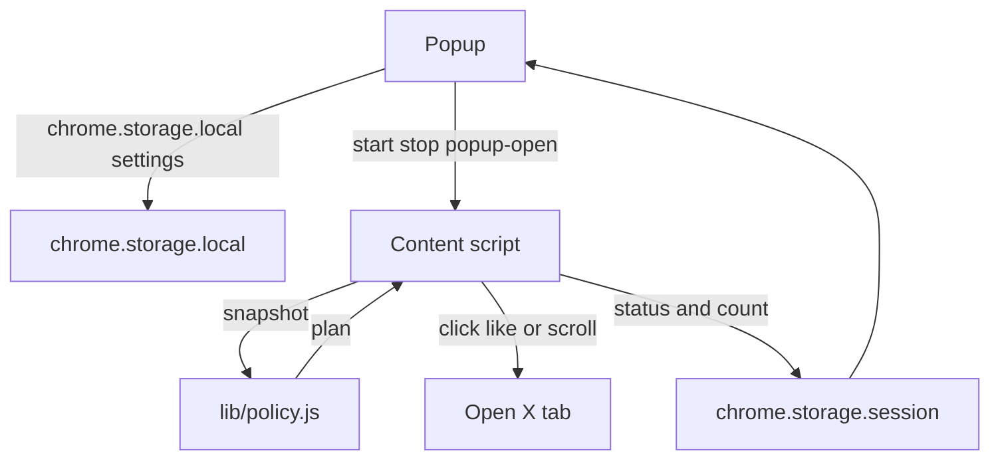

# X Likes Automator Design

**Spec**: `.specs/features/likes-session/spec.md`
**Status**: Approved

Approved under the request's autonomous mode. The product decisions are already made. Gray areas are assumptions in the spec, not open questions.

---

## Architecture Overview

The content script owns the session loop inside the open X tab. It reads a plain snapshot from the page and calls pure functions in `lib/policy.js`. The popup reads and writes settings and renders the status those functions name. There is no background service worker, because a worker with alarms would keep liking after the user leaves the tab.

Three approaches were considered. All of them deliver the same v1 scope.

1. **Content-script loop plus a pure policy module.** Chosen. The loop dies with the tab's visibility, the rules are importable from `node --test`, and Load unpacked needs no build.
2. **Service worker and `chrome.alarms`.** Rejected. Alarm periods are coarse, and the worker would schedule work while the user is on another site. That breaks the inactive-tab rule.
3. **One classic script and no shared module.** Rejected. The popup and the content script would each carry a copy of the rules, and node could not import them without a bundler.



---

## Code Reuse Analysis

### Existing Components to Leverage

| Component | Location | How to Use |
| --- | --- | --- |
| None | repository root | Greenfield. No product code exists yet. |

### Integration Points

| System | Integration Method |
| --- | --- |
| chrome.storage.local | Key `settings`. Popup writes the validated object. Content script reads it at start and on change. |
| chrome.storage.session | Key `session`. Content script writes `{ status, likeCount, running, stopReason }`. Popup reads it for the live line. |
| chrome.runtime | Popup sends `start`, `stop`, `popup-open`, and `popup-close` to the X tab. Content script answers with the session snapshot. |
| Page DOM | Content script only. Selectors stay in `content/content.js`. Policy never sees a DOM node. |

---

## Components

### policy

- **Purpose**: Decide what the session does next, with no DOM and no Chrome APIs.
- **Location**: `lib/policy.js`
- **Interfaces**:
  - `defaultSettings(): Settings` - the spec defaults
  - `validateSettings(input): { ok: true, settings: Settings } | { ok: false, errors: string[] }` - interval and cap bounds
  - `settingsErrorMessage(code): string` - exact Portuguese sentence
  - `statusMessage(code): string` - exact Portuguese sentence
  - `classifySurface(url: string): 'home' | 'profile' | 'search' | 'status' | 'other'`
  - `annotateThread(posts, surface): AnnotatedPost[]` - marks `original` only on a status reply thread
  - `selectNextLike(posts, seenIds, likeOriginal): { id: string } | null`
  - `nextDelayMs(intervalSeconds, randomUnit): number`
  - `activityDecision(flags): 'run' | 'pause'`
  - `blurPauseDelayMs({ becameHidden, popupOpen }): number | null`
  - `capDecision(likeCount, settings): { reached: boolean }`
  - `scrollDecision(snapshot): { action, nextBackoffStep, waitMs }`
  - `chooseScrollTarget({ documentScrollable, columnScrollable }): 'document' | 'column' | 'none'`
  - `planTick(state): Plan`
  - `applyPlan(session, plan, settings): Session`
  - `startSession(): Session`
  - `stopSession(session): Session`
  - `allowedAction(action): boolean`
- **Dependencies**: none
- **Reuses**: none

### manifest

- **Purpose**: Declare MV3, the two hosts, storage, the popup, and the content script.
- **Location**: `manifest.json`
- **Interfaces**: Chrome extension manifest, version 3
- **Dependencies**: popup files, content script, PNG icons
- **Reuses**: none

### icon

- **Purpose**: Original mark for the toolbar and the extensions page.
- **Location**: `icons/icon.svg` plus `icons/icon-16.png`, `icons/icon-32.png`, `icons/icon-48.png`, `icons/icon-128.png`
- **Interfaces**: SVG source. PNG files referenced by the manifest.
- **Dependencies**: none
- **Reuses**: none

### content script

- **Purpose**: Turn the page into a snapshot, execute the plan, and publish status.
- **Location**: `content/content.js`
- **Interfaces**:
  - Collects posts as `{ id, liked, isReply }` in visual order
  - Clicks only `button[data-testid="like"]` for the id `planTick` returned
  - Scrolls the target from `chooseScrollTarget`
  - Listens to `visibilitychange` and `blur` / `focus`
  - On `start`, replaces the session with `startSession`. On `stop`, uses `stopSession`.
- **Dependencies**: `lib/policy.js`, chrome.storage, chrome.runtime
- **Reuses**: policy

### popup document

- **Purpose**: Portuguese controls and a live status region.
- **Location**: `popup/popup.html`
- **Interfaces**: form controls with labels, `aria-live="polite"` status, `lang="pt-BR"`
- **Dependencies**: `popup/popup.css`, `popup/popup.js`
- **Reuses**: status strings from policy, rendered by the controller

### popup stylesheet

- **Purpose**: Dark theme, readable type, and a visible keyboard focus ring.
- **Location**: `popup/popup.css`
- **Interfaces**: `--bg: #12141a`, `--text: #f4f1ea`, `:focus-visible` outline
- **Dependencies**: none
- **Reuses**: none

### popup controller

- **Purpose**: Load and save settings, start and stop the active X tab, and paint status.
- **Location**: `popup/popup.js`
- **Interfaces**:
  - `createController({ storage, tabs, runtime, document, now }): Controller`
  - Refuses `storage.set` when `validateSettings` fails
  - Sends `popup-open` on boot and `popup-close` on `pagehide`
- **Dependencies**: `lib/policy.js`
- **Reuses**: policy

---

## Data Models

### Settings

```typescript
interface Settings {
  intervalSeconds: number // integer 1..60, default 5
  capEnabled: boolean // default false
  cap: number // integer 1..1000000, default 100, ignored while capEnabled is false
  likeOriginalInReplyThread: boolean // default true
}
```

**Relationships**: Stored at `chrome.storage.local` key `settings`. `validateSettings` is the only writer of a stored object.

### Session

```typescript
interface Session {
  running: boolean
  likeCount: number
  seenIds: string[]
  stopReason: null | 'user' | 'cap'
  status: 'stopped' | 'running' | 'paused_inactive' | 'waiting_for_posts' | 'not_logged_in' | 'cap_reached' | 'unsupported_page'
  backoffStep: number
}
```

**Relationships**: `seenIds` stays in the content-script memory. The published snapshot omits `seenIds` and is written to `chrome.storage.session` key `session`.

### Post snapshot

```typescript
interface PostSnapshot {
  id: string
  liked: boolean
  isReply: boolean
}
```

**Relationships**: Built by the content script. `annotateThread` adds `role: 'original' | 'reply' | 'post'`.

### Plan

```typescript
interface Plan {
  action: 'idle' | 'pause' | 'block_login' | 'stop_cap' | 'skip_surface' | 'like' | 'scroll' | 'observe' | 'wait'
  status: Session['status']
  waitMs: number
  postId?: string
  nextBackoffStep?: number
}
```

**Relationships**: `planTick` returns it. `applyPlan` folds it into the next session. The content script performs the side effect.

---

## Error Handling Strategy

| Error Scenario | Handling | User Impact |
| --- | --- | --- |
| Interval or cap out of bounds | `validateSettings` fails. Popup does not call `storage.set`. | Portuguese error under the field. Previous settings stay. |
| Login wall | Plan `block_login`. No click. Recheck in 2000 ms. | Status "Entre no X nesta aba para começar". |
| Feed does not advance | Plan `wait` with the backoff ladder. Session stays running. | Status "Aguardando novos posts". |
| Page scrolls itself | Plan `observe`. No extra scroll that cycle. | Session keeps "Curtindo" and looks again in 500 ms. |
| Post has no numeric id | Skip the candidate. | That card is ignored. |
| Current tab is not X | Controller refuses start. | Start does not arm a foreign tab. |
| X markup has no like button | Treated as no eligible post. Scroll or wait. | Session continues. |
| Tab hidden or window blurred | Plan `pause` immediately, or after 200 ms when the popup might be opening. | Status "Pausado: a aba do X não está ativa". Count stays. |

---

## Risks & Concerns

| Concern | Location (file:line) | Impact | Mitigation |
| --- | --- | --- | --- |
| Greenfield repo, no existing tests or conventions | `D:\eleicoes\x-likes-automator` | Nothing to copy for structure | Strong default: one node:test assertion per spec outcome in `lib/policy.js` |
| X changes `data-testid` values | `content/content.js` (planned) | Collector returns no posts and the session waits | Selectors live in one collector. Policy tests stay on snapshots, so a DOM change does not rewrite the rules. |
| Unpacked Chrome rejects SVG manifest icons | `manifest.json` (planned) | Toolbar icon missing or the extension warns | Commit PNG sizes. `icon.svg` remains the original source and is not referenced by the manifest. |
| Opening the popup blurs the page | `content/content.js` (planned) | A literal focus check would pause whenever the user looks at status | `blurPauseDelayMs` waits 200 ms and does not pause when the popup is open and the document is visible |
| Login wall guessed from copy alone | `content/content.js` (planned) | A false wall would block a logged-in feed | Wall is true only when a login or signup entry is visible and the page has zero post articles |

---

## Tech Decisions

| Decision | Choice | Rationale |
| --- | --- | --- |
| Module format | ES modules, `"type": "module"` in package.json for node:test | Content scripts declare `"type": "module"` and import `../lib/policy.js`. No bundler. |
| Permissions | `storage` plus host permissions for `https://x.com/*` and `https://twitter.com/*` | Enough to message those tabs and store settings. No cookies, tabs, or identity permission. |
| Like control | Click `button[data-testid="like"]` only | That is the page's own not-yet-liked control. The already-liked control is never clicked. |
| Icon pipeline | Hand-written SVG, PNG rasters generated on the machine and committed | Unpacked Chromium requires PNG. Users do not run a generator. |
| Test runner | `node --test` | Built into Node. No devDependency is required to run the suite. |

Project-level decision AD-001 in `.specs/STATE.md` records the no-build policy-module shape.
