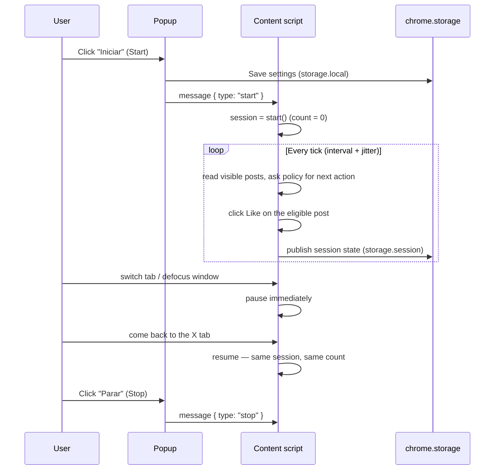

<div align="center">

# X Likes Automator

**Auto-likes visible posts on X (Twitter) — right inside the tab you already have open.**

[](LICENSE)


**English** · [Português](README.pt-BR.md)

</div>

---

**X Likes Automator** is a Manifest V3 browser extension that clicks the Like button on
visible posts that have not been liked yet. It works only in the X (or Twitter)
tab you already have open and where you are already signed in. It does not ask for
a password, read cookies, or use an X API token — it simply uses the page the way
you would, at a pace you configure.

- **Repository:** <https://github.com/paladini/x-likes-automator>
- **Release:** [v1.0.0](https://github.com/paladini/x-likes-automator/releases/tag/v1.0.0)
- **Author:** Fernando Paladini
- **License:** MIT

> [!WARNING]
> Automated likes can conflict with X's rules and Terms of Service. You are responsible for how you use this extension. Your account may be rate-limited, restricted, or suspended. Read the full [Disclaimer](#disclaimer--x-rules) before running a session.

---

## Table of contents

- [Features](#features)
- [How it works](#how-it-works)
- [Requirements](#requirements)
- [Installation](#installation)
- [Tutorial — your first session](#tutorial--your-first-session)
- [Settings reference](#settings-reference)
- [Status messages](#status-messages)
- [Supported and unsupported pages](#supported-and-unsupported-pages)
- [Behavior you should know](#behavior-you-should-know)
- [Privacy and security](#privacy-and-security)
- [Troubleshooting](#troubleshooting)
- [Development](#development)
- [Contributing](#contributing)
- [Disclaimer — X's rules](#disclaimer--x-rules)
- [License](#license)

---

## Features

| | |
|---|---|
| **Likes only what is eligible** | Visible posts that are not liked yet. Already-liked posts are never touched, and a post is never liked twice in the same session. |
| **Runs in your open tab** | Uses the X tab you already have open and where you are already logged in. No login flows, no credentials, no API tokens. |
| **Unlimited by default** | There is no hardcoded cap of 30 likes. The default session is unlimited until you stop it. You can turn on an optional cap in settings (1 – 1,000,000). |
| **Human-like pacing** | Likes are spaced by your configured interval (1 – 60 seconds) with a small randomized jitter that always stays inside the interval you chose. |
| **Instant auto-pause** | If the tab is hidden or the window loses focus, liking pauses immediately. When the tab is active again, the same session resumes and the count stays. |
| **Auto-scroll and waiting** | When nothing eligible is visible, the extension scrolls the timeline to find more posts and, when it runs out, waits with exponential backoff (up to 30 s) for new posts. |
| **Thread-aware** | Option to like (or skip) the original post in a reply thread. On the home timeline, a profile, and search, visible posts that are not liked yet are always eligible. |
| **EN / PT UI compatible** | Detects Like button states in both English (`Like` / `Unlike`) and Portuguese (`Curtir` / `Descurtir`), regardless of your X language. |
| **Hard refusal list** | The policy layer only allows the `like` action. Repost, reply, follow, DM, login and cookie collection are structurally refused — the extension cannot be "extended" into them by configuration. |
| **Zero build, zero dependencies** | Plain JavaScript, loaded unpacked straight from the repository. The test suite runs on Node's built-in test runner. |

The popup UI itself is in Brazilian Portuguese (`pt-BR`); every label is translated
in the [Settings reference](#settings-reference) below.

---

## How it works

The extension has three moving parts:

```
┌────────────┐  runtime messages    ┌──────────────────┐  pure rules    ┌──────────────┐
│   popup    │ ◄───────────────────►│ content script   │ ──────────────►│  policy.js   │
│ (controls, │  start / stop /      │ (DOM reader +    │  planTick() /  │ (decision    │
│  settings) │  status              │  clicker)        │  applyPlan()   │  engine)     │
└─────┬──────┘                      └────────┬─────────┘                └──────┬───────┘
      │          chrome.storage.local        │      chrome.storage.session     │
      └──────────── settings ────────────────┴──── live session state ─────────┘
```

- **`lib/policy.js`** — a pure, fully tested decision engine. It validates settings,
  classifies the current page (home, profile, search, status thread, or unsupported),
  picks the next eligible post, schedules the next delay with jitter, and decides
  whether to like, scroll, observe, wait, pause, or stop.
- **`content/content.js`** — a DOM adapter. It collects posts from the page, reads the
  state of each Like button, clicks the button for the post chosen by the policy,
  scrolls when needed, and listens for visibility/focus events. It keeps no policy
  logic of its own.
- **`popup/popup.js`** — the control surface. It persists settings to
  `chrome.storage.local`, sends `start` / `stop` messages to the content script, and
  renders the live session status mirrored in `chrome.storage.session`.

A session tick looks like this:



---

## Requirements

- **A Chromium browser with Manifest V3 support:** Google Chrome, Brave, or Microsoft
  Edge. The extension relies on the CSS `:has()` selector for post detection, so you
  need **Chrome / Edge 105+** (or a current Brave release).
- **A logged-in X account** in a normal browser tab. The extension never logs you in
  and never touches credentials.
- **No Node.js required to run it.** Node 20+ is only needed to run the test suite.

---

## Installation

There is no build step. Download the release zip or clone the repository, then load that folder unpacked. The extension only likes posts in the X tab you already have open. It does not open a new window.

### Download

1. Download [x-likes-automator-1.0.0.zip](https://github.com/paladini/x-likes-automator/releases/download/v1.0.0/x-likes-automator-1.0.0.zip) from the [v1.0.0 release](https://github.com/paladini/x-likes-automator/releases/tag/v1.0.0).
2. Unzip it. The folder must contain `manifest.json` at the top level.
3. Load that folder unpacked, using the steps below.

### Google Chrome

1. Download or clone this repository:
   ```bash
   git clone https://github.com/paladini/x-likes-automator.git
   ```
2. Open `chrome://extensions`.
3. Turn on **Developer mode** (toggle in the top-right corner).
4. Click **Load unpacked**.
5. Select the `x-likes-automator` folder — the one that contains `manifest.json`.
6. (Recommended) Click the puzzle-piece icon in the toolbar and **pin** *X Likes
   Automator* so the popup is one click away.

### Brave

1. Open `brave://extensions`.
2. Turn on **Developer mode**.
3. Click **Load unpacked**.
4. Select the folder that contains `manifest.json`.

### Microsoft Edge

1. Open `edge://extensions`.
2. Turn on **Developer mode** (bottom-left).
3. Click **Load unpacked**.
4. Select the folder that contains `manifest.json`.

---

## Tutorial — your first session

This walkthrough takes you from an empty timeline to a running, pausing, and stopping
session, explaining every control along the way.

### Step 1 — Open X in a tab and sign in

Go to `https://x.com/home` in a regular browser tab and make sure you are logged in.
If you see a login wall instead of your timeline, the extension will detect it, show
**"Entre no X nesta aba para começar"** ("Sign in to X in this tab to start"), and
re-check every 2 seconds. As soon as you sign in, a running session resumes by itself.

### Step 2 — Open the popup

Click the pinned *X Likes Automator* toolbar icon. The popup shows:

- the current **status** (initially `Parado` — "Stopped"),
- the **like count** for the current session,
- the four settings described in the [reference below](#settings-reference).

> Opening the popup does **not** pause a running session. The extension knows the
> popup is open and keeps working while you watch the counter.

### Step 3 — Configure the pace

Set **Intervalo entre curtidas** ("Interval between likes") to `5` seconds for a
conservative first run. The real delay between two likes is randomized to
**85–100% of the interval** (so 4.25–5 s for a 5 s setting), which keeps the rhythm
less robotic. A 1 s setting is a constant 1 s.

### Step 4 — Choose a limit (or don't)

**Sem limite de curtidas** ("Unlimited likes") is **on by default**: the session runs
until *you* stop it. To use a cap, uncheck it and set **Limite de curtidas nesta
sessão** ("Like cap for this session", default 100, allowed 1–1,000,000). When the cap
is reached the session stops by itself and the popup shows **"Limite da sessão
atingido"**. Pressing Start begins a fresh session with the count reset to 0.

### Step 5 — Reply-thread behavior

**Curtir o post original em uma thread de resposta** ("Like the original post in a
reply thread") is **on by default**. When you run a session on a single-post page
(`x.com/<user>/status/<id>`) that contains replies, the extension treats the first
non-reply post as the *original* of the thread and likes it along with the replies.
Turn this off if you want replies liked but the thread's original post left alone.
On the home timeline, a profile, and search this toggle changes nothing — every
visible, not-yet-liked post is eligible.

### Step 6 — Press "Iniciar" (Start)

The popup status changes to **"Curtindo"** ("Liking"). The extension now walks the
visible posts in page order, clicking Like only on posts that are not liked yet, with
your configured pacing. A post it has already handled is never re-liked in the same
session, even if you scroll back up.

If the active tab is not an X tab, pressing Start shows **"Abra uma aba do X para
iniciar."** ("Open an X tab to start.") — nothing else happens.

### Step 7 — Let it run: scrolling and waiting

When every eligible post on screen has been liked, the extension scrolls down about
80% of a viewport (the page document or X's primary column, whichever actually
scrolls), then observes the newly loaded posts. If nothing new appears, it waits with
exponential backoff — 2 s, 4 s, 8 s … capped at 30 s — and the status shows
**"Aguardando novos posts"** ("Waiting for new posts"). As soon as a scroll or a new
load reveals something eligible, it likes it immediately and the backoff resets.

### Step 8 — Pause and resume, automatically

Switch to another tab, minimize the window, or move focus to another app: liking
**pauses immediately** and the status becomes **"Pausado: a aba do X não está ativa"**
("Paused: the X tab is not active"). Click back on the X tab: the *same* session
resumes with the *same* count. There is no resume button — presence is the switch.

### Step 9 — Stop the session

Click **Parar** ("Stop"). The status returns to **Parado** and the final count stays
visible in the popup. The session state lives in `chrome.storage.session`, so you can
reopen the popup later in the same browser run and still see the count. Restarting the
browser (or pressing Start again) begins a fresh session at 0.

### Step 10 — Verify, tweak, repeat

Open the popup mid-session and watch the counter increment live. Adjust the interval
or the cap and press Start again — settings are saved on every Start and applied to
the new session.

---

## Settings reference

All settings are persisted in `chrome.storage.local` and are validated before saving.
Invalid values are rejected with an inline error in the popup.

| Popup label (pt-BR) | English meaning | Type | Range | Default |
|---|---|---|---|---|
| Intervalo entre curtidas (segundos) | Interval between likes | integer seconds | 1 – 60 | 5 |
| Sem limite de curtidas | Unlimited likes | checkbox | on / off | **on** |
| Limite de curtidas nesta sessão | Like cap for this session (used only when Unlimited is off) | integer | 1 – 1,000,000 | 100 |
| Curtir o post original em uma thread de resposta | Like the original post in a reply thread | checkbox | on / off | **on** |

Validation messages shown by the popup:

- *"O intervalo precisa ser um número inteiro de 1 a 60."* — the interval must be an
  integer from 1 to 60.
- *"O limite precisa ser um número inteiro de 1 a 1000000."* — the cap must be an
  integer from 1 to 1,000,000.

---

## Status messages

The status line in the popup is one of these seven states.

| Popup (pt-BR) | English | Meaning |
|---|---|---|
| `Parado` | Stopped | No session is running. |
| `Curtindo` | Liking | A session is active and liking eligible posts. |
| `Pausado: a aba do X não está ativa` | Paused: the X tab is not active | Auto-paused because the tab is hidden or the window lost focus. Resumes when you return. |
| `Aguardando novos posts` | Waiting for new posts | Nothing eligible is visible; the extension is scrolling/waiting (backoff up to 30 s). |
| `Entre no X nesta aba para começar` | Sign in to X in this tab to start | A login wall was detected. Re-checked every 2 s. |
| `Limite da sessão atingido` | Session cap reached | The optional cap was hit; the session stopped itself. |
| `Esta página do X não entra na curtida automática` | This X page is not part of automatic liking | You navigated to an unsupported page. Re-checked every 2 s; returning to a supported page resumes. |

---

## Supported and unsupported pages

The policy engine classifies the current URL into a *surface*. Only these surfaces are
eligible for automatic liking:

| Surface | Examples | Notes |
|---|---|---|
| Home timeline | `x.com/`, `x.com/home` | The classic use case. |
| Search results | `x.com/search?q=…` | Visible results are liked top-to-bottom as you scroll. |
| Profile | `x.com/<handle>`, plus the `with_replies`, `media`, and `likes` tabs | Posts are eligible only if not liked yet — on the *Likes* tab, everything is already liked, so nothing new will be clicked. |
| Single post / thread | `x.com/<handle>/status/<id>` | Replies are liked in page order; the original post follows the reply-thread toggle. |

Everything else — `explore`, `notifications`, `messages`, `settings`, `compose`, and
any non-X site — is reported as **"Esta página do X não entra na curtida automática"**
and revisited every 2 seconds. Navigate back to a supported page and the session
resumes exactly where it left off.

---

## Behavior you should know

- **Eligibility rules.** A post is liked only if it is rendered in the page, not
  liked yet (by button state), has a numeric status id, and was not already handled
  this session. Quoted and nested posts inside a bigger post are ignored — only the
  outermost post is considered.
- **Visibility first.** Before clicking, the post is smoothly scrolled into view if
  it is only partially visible. Nothing is ever clicked off-screen.
- **Never unlikes.** Already-liked posts are skipped; the button is only ever clicked
  when its state reads *not liked yet*.
- **The popup never pauses the run.** Opening it marks the session as
  "popup open", which overrides focus-loss detection (there is also a 200 ms grace
  period so merely opening the popup never triggers a pause).
- **Full page reloads end the session.** The runner lives inside the page. SPA
  navigation (timeline → profile → back) keeps the session and the count, but a hard
  reload (F5) re-injects the content script and the session is gone — press Start
  again. The like count for the reloaded page starts at 0.
- **Like clicks can transiently fail** (X re-rendering the post); the extension
  detects this, treats it as "waiting for posts", and retries.
- **No persistence of liked-post history.** `seenIds` is per session. A brand-new
  session may re-encounter posts it liked earlier — they will simply be skipped
  because they are already liked.

---

## Privacy and security

The extension declares the minimum Chrome API surface it needs:

| Permission | Why |
|---|---|
| `storage` | Save settings (`storage.local`) and mirror live session state to the popup (`storage.session`). |
| Host access: `https://x.com/*`, `https://twitter.com/*` | The content script must run on X pages and the popup must send it messages. |

What it **never** does:

- ❌ No cookies read or written, no passwords, no session tokens, no X API keys.
- ❌ No network requests of its own — it performs no `fetch`/XHR, sends analytics, or
  phones home. All state stays in `chrome.storage`.
- ❌ No other sites. The content script only injects on `x.com` and `twitter.com`.
- ❌ No unsafe actions, by design. The policy layer exposes a refusal set (`repost`,
  `reply`, `follow`, `dm`, `login`, `collect_cookies`) and `allowedAction()` only ever
  returns `true` for `"like"`.

---

## Troubleshooting

| Symptom | Cause | Fix |
|---|---|---|
| *"Abra uma aba do X para iniciar."* | The active tab is not an X page. | Click Start while an `x.com` / `twitter.com` tab is active. |
| *"Recarregue a aba do X e toque em Iniciar de novo."* | The content script isn't in the page — the tab was opened before the extension was installed or updated. | Reload the X tab (F5), then press Start. |
| Status stays `Parado` after a browser restart | Session state lives in `chrome.storage.session`, which is cleared on browser shutdown (by design — nothing sensitive persists). | Press Start. Settings survive; only the run state is volatile. |
| Nothing gets liked while status is `Curtindo` | All visible posts are already liked, or the page is a supported surface that simply has no eligible posts. | The extension auto-scrolls and waits; add content, or check the [supported pages](#supported-and-unsupported-pages) table. |
| `Pausado: a aba do X não está ativa` forever | The X tab is not the visible/focused one. | Click the X tab. The session resumes with the same count. |
| `Esta página do X não entra na curtida automática` | You navigated to explore/notifications/messages/settings or another site. | Navigate back to home, search, a profile, or a thread. |
| You edited the extension code and it feels stale | Unpacked extensions cache the old script in already-open tabs. | Reload the extension at `chrome://extensions`, **then** reload the X tab. |
| X is shown in a third language and nothing is liked | Like-button `aria-label` detection currently covers English and Portuguese. | Switch X to English or Brazilian Portuguese, or open an issue with the label text you see. |

---

## Development

No build step, no runtime dependencies. The whole repo is the extension.

```bash
git clone https://github.com/paladini/x-likes-automator.git
cd x-likes-automator
npm test        # runs node --test (Node 20+); no install step needed
```

### Repository layout

```
x-likes-automator/
├── manifest.json         # Manifest V3: permissions, content script, popup
├── lib/
│   └── policy.js         # Pure decision engine (validation, planning, session rules)
├── content/
│   └── content.js        # DOM adapter: collects posts, clicks Like, scrolls, listens to events
├── popup/
│   ├── popup.html        # Popup UI (labels in Brazilian Portuguese)
│   ├── popup.css
│   └── popup.js          # Controller: settings I/O, start/stop messaging, live status
├── icons/                # 16 / 32 / 48 / 128 px toolbar icons
├── test/                 # node:test suites: policy, content adapter, popup markup/controller, manifest, README, icon
├── LICENSE               # MIT
├── README.md             # this file (English)
└── README.pt-BR.md       # Brazilian Portuguese translation
```

### The architecture rule that keeps tests honest

`lib/policy.js` owns every decision (a pure `planTick` → `applyPlan` loop with no DOM
access) and `content/content.js` owns every DOM interaction behind small injected
functions (`readSnapshot`, `clickLike`, `scrollBy`, `publish`, `schedule`). That seam
is what makes the entire engine unit-testable in plain Node — keep DOM logic out of
policy and policy logic out of the adapter.

### Development loop

1. Edit files (there is nothing to compile).
2. Run `npm test`.
3. Load the folder unpacked as shown in [Installation](#installation).
4. After changing extension files: press **Reload** on the extension card at
   `chrome://extensions`, then reload the X tab.
5. For quick policy experiments, import `lib/policy.js` in Node and call
   `globalThis.XLikesPolicy.planTick(state)` directly — it is dependency-free.

---

## Contributing

Contributions are welcome. Suggested flow:

1. Fork the repository and create a branch from `main`.
2. Keep changes small and focused; one behavior per pull request.
3. Add or update a test for every behavior change — the suites run on
   `node --test` with no dependencies.
4. Run `npm test` and make sure it is green before opening the PR.
5. Describe what changed and how you verified it. If you touched DOM selectors
   (`content/content.js` or `popup/*.test.js` fixtures), say which X UI variant you
   tested against.

Open an issue first for anything larger than a fix — the refusal list and the
"open tab only" scope are deliberate and unlikely to change.

---

## Disclaimer — X's rules

Automated likes can conflict with X's rules and its Terms of Service. Accounts that
like at scale may be rate-limited or restricted. This extension is provided as-is for
educational and personal use. You are responsible for how you use this extension and
for any consequences on your account. Keep the interval conservative, use a cap if in
doubt, and stop immediately if X shows any warning.

---

## License

MIT © 2026 [Fernando Paladini](https://github.com/paladini). See [LICENSE](LICENSE).
Full Portuguese documentation: [README.pt-BR.md](README.pt-BR.md).
