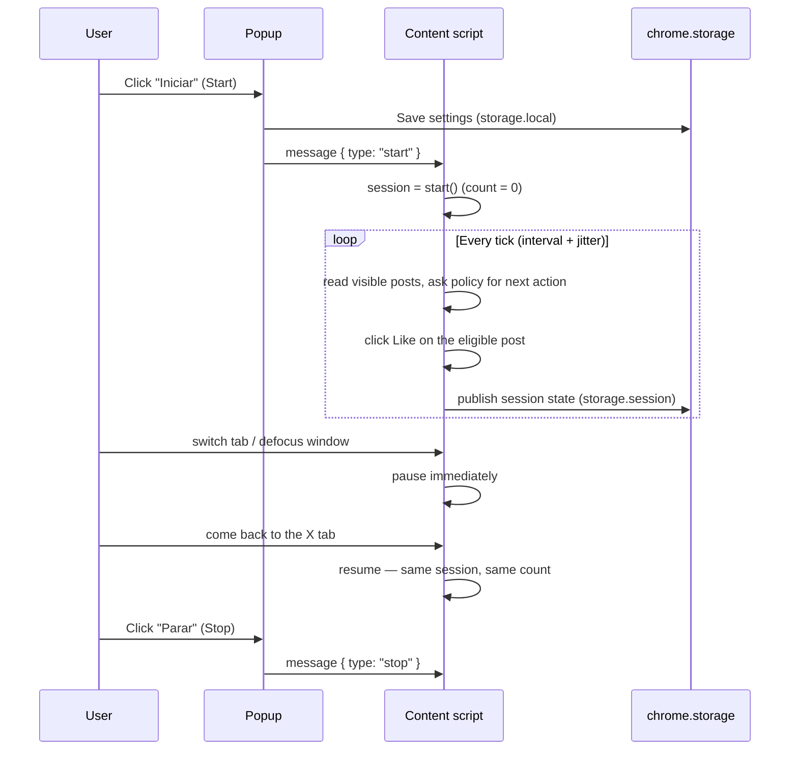

<div align="center">

# X Likes Automator

**Auto-likes visible posts on X (Twitter) — right inside the tab you already have open.**

[](LICENSE)


[](https://github.com/paladini/x-likes-automator/actions/workflows/test.yml)

**English** · [Português](README.pt-BR.md)

</div>

---

**X Likes Automator** is a Manifest V3 browser extension that clicks the Like button on
visible posts that have not been liked yet. It works only in the X (or Twitter)
tab you already have open and where you are already signed in. It does not ask for
a password, read cookies, or use an X API token — it simply uses the page the way
you would, at a pace you configure.

- **Repository:** <https://github.com/paladini/x-likes-automator>
- **Release:** [v1.1.0](https://github.com/paladini/x-likes-automator/releases/tag/v1.1.0)
- **Changelog:** [CHANGELOG.md](CHANGELOG.md)
- **Author:** Fernando Paladini
- **License:** MIT

> [!WARNING]
> Automated likes can conflict with X's rules and Terms of Service. You are responsible for how you use this extension. Your account may be rate-limited, restricted, or suspended. Read the full [Disclaimer](#disclaimer--xs-rules) before running a session.

---

## Table of contents

- [Features](#features)
- [How it works](#how-it-works)
- [Requirements](#requirements)
- [Installation](#installation)
- [Tutorial — your first session](#tutorial--your-first-session)
- [Settings reference](#settings-reference)
- [Status messages](#status-messages)
- [Supported and unsupported pages](#supported-and-unsupported-pages)
- [Privacy and security](#privacy-and-security)
- [Troubleshooting](#troubleshooting)
- [Documentation](#documentation)
- [Development](#development)
- [Contributing](#contributing)
- [Disclaimer — X's rules](#disclaimer--xs-rules)
- [License](#license)

---

## Features

| | |
|---|---|
| **Likes only what is eligible** | Visible posts that are not liked yet. A post is never liked twice in the same session. |
| **Runs in your open tab** | Uses the X tab you already have open and where you are already logged in. No login flows, no credentials, no API tokens. |
| **Unlimited by default** | There is no hardcoded cap of 30 likes. The default session is unlimited until you stop it. You can turn on an optional cap in settings (1 – 1,000,000). |
| **Human-like pacing** | Likes are spaced by your configured interval (1 – 60 seconds) with a small randomized jitter that always stays inside the interval you chose. |
| **Instant auto-pause** | If the tab is hidden or the window loses focus, liking pauses immediately. When the tab is active again, the same session resumes and the count stays. |
| **Reload-proof sessions** | The tab reloads itself every 5 minutes (and survives your own F5) — the session resumes automatically with the same count. Only a browser restart asks you to press Start again. |
| **Auto-scroll and waiting** | When nothing eligible is visible, the extension scrolls the timeline to find more posts and, when it runs out, waits with exponential backoff (up to 30 s) for new posts. |
| **Thread-aware** | Option to like (or skip) the original post in a reply thread. On the home timeline, a profile, and search, visible posts that are not liked yet are always eligible. |
| **Plain repost, optional** | **Repostar também** is on by default. The extension clicks the repost icon, then only the plain menu item (share with no phrase). It never opens a composer and never types. Already-reposted posts are skipped. |
| **Respects X's warnings** | When X shows the *"this looks automated"* notice, the session waits a full minute and resumes — it never tries to dodge the protection. |
| **Interface language** | The parser uses the language you pick. Default is Português (Brasil). The popup lists every language whose Like, Unlike, Repost, Undo repost, and Quote labels were copied from X's locale bundles. |
| **Hard refusal list** | Quote and comment composers, reply, follow, DM, login, and cookie collection stay refused. |
| **Zero build, zero dependencies** | Plain JavaScript, loaded unpacked straight from the repository. The test suite runs on Node's built-in test runner. |

The popup UI itself is in Brazilian Portuguese (`pt-BR`); every label is translated
in the [Settings reference](#settings-reference) below.

---

## How it works

The extension has three moving parts:

```
┌────────────┐  runtime messages    ┌──────────────────┐  pure rules    ┌──────────────┐
│   popup    │ ◄───────────────────►│ content script   │ ──────────────►│  policy.js   │
│ (controls, │  start / stop /      │ (DOM reader +    │  planTick() /  │ (decision    │
│  settings) │  status              │  clicker)        │  applyPlan()   │  engine)     │
└─────┬──────┘                      └────────┬─────────┘                └──────┬───────┘
      │          chrome.storage.local        │      chrome.storage.session     │
      └──────────── settings ────────────────┴──── live session state ─────────┘
```

- **`lib/policy.js`** — a pure, fully tested decision engine. It validates settings,
  classifies the current page (home, profile, search, status thread, or unsupported),
  picks the next eligible post, schedules the next delay with jitter, and decides
  whether to like, repost, scroll, observe, wait, pause, or stop.
- **`content/content.js`** — a DOM adapter. It collects posts from the page, reads the
  state of each Like button, clicks the button for the post chosen by the policy,
  scrolls when needed, reloads the tab every 5 minutes, and listens for
  visibility/focus events. It keeps no policy logic of its own.
- **`popup/popup.js`** — the control surface. It persists settings to
  `chrome.storage.local`, sends `start` / `stop` messages to the content script, and
  renders the live session status mirrored in `chrome.storage.session`.

A session tick looks like this:



The full engine walk-through — the decision ladder, the repost sub-chain, the
reload-and-resume marker, the test seams — lives in
[docs/architecture.md](docs/architecture.md).

---

## Requirements

- **A Chromium browser with Manifest V3 support:** Google Chrome, Brave, or Microsoft
  Edge. The extension relies on the CSS `:has()` selector for post detection, so you
  need **Chrome / Edge 105+** (or a current Brave release).
- **A logged-in X account** in a normal browser tab. The extension never logs you in
  and never touches credentials.
- **No Node.js required to run it.** Node 20+ is only needed to run the test suite.

---

## Installation

There is no build step. Download the release zip or clone the repository, then load that folder unpacked. The extension only likes posts in the X tab you already have open. It does not open a new window.

### Download

1. Download [x-likes-automator-1.1.0.zip](https://github.com/paladini/x-likes-automator/releases/download/v1.1.0/x-likes-automator-1.1.0.zip) from the [v1.1.0 release](https://github.com/paladini/x-likes-automator/releases/tag/v1.1.0).
2. Unzip it. The folder must contain `manifest.json` at the top level.
3. Load that folder unpacked, using the steps below.

### Google Chrome

1. Download or clone this repository:
   ```bash
   git clone https://github.com/paladini/x-likes-automator.git
   ```
2. Open `chrome://extensions`.
3. Turn on **Developer mode** (toggle in the top-right corner).
4. Click **Load unpacked**.
5. Select the `x-likes-automator` folder — the one that contains `manifest.json`.
6. (Recommended) Click the puzzle-piece icon in the toolbar and **pin** *X Likes
   Automator* so the popup is one click away.

### Brave

1. Open `brave://extensions`.
2. Turn on **Developer mode**.
3. Click **Load unpacked**.
4. Select the folder that contains `manifest.json`.

### Microsoft Edge

1. Open `edge://extensions`.
2. Turn on **Developer mode** (bottom-left).
3. Click **Load unpacked**.
4. Select the folder that contains `manifest.json`.

---

## Tutorial — your first session

This walkthrough takes you from an empty timeline to a running, pausing, and stopping
session, explaining every control along the way. A longer version with a first-run
checklist lives in [docs/getting-started.md](docs/getting-started.md).

1. **Open X in a tab and sign in.** Go to `https://x.com/home`. If you see a login
   wall, the extension detects it, shows *"Entre no X nesta aba para começar"*, and
   re-checks every 2 seconds — a running session resumes by itself once you sign in.
2. **Open the popup.** Click the pinned *X Likes Automator* icon. You see the status
   (initially `Parado`), the session counter, and the settings below. Opening the
   popup does **not** pause a running session — you can watch the counter climb.
3. **Set the pace.** **Intervalo entre curtidas** (interval between likes, seconds).
   Real delays are randomized to 85–100 % of the value (a 5 s setting draws from
   4.25–5 s), which keeps the rhythm less robotic. A 1 s setting is a constant 1 s.
4. **Choose a limit (or don't).** **Sem limite de curtidas** (unlimited likes) is on
   by default. Uncheck it to use the optional cap **Limite de curtidas nesta sessão**
   (default 100): the session stops itself at the cap with *"Limite da sessão
   atingido"*.
5. **Thread and repost toggles.** **Curtir o post original em uma thread de resposta**
   (like the original post in a reply thread) and **Repostar também** (also repost,
   plain menu item only) are both on by default. See the
   [settings reference](#settings-reference) for exact semantics.
6. **Press Iniciar.** The status becomes **"Curtindo"** and posts start flowing in
   page order. Already-liked posts are skipped; nothing is clicked twice per session.
7. **Let it run.** When the screen runs out, it scrolls ~80 % of a viewport, observes
   what loaded, and otherwise waits with exponential backoff up to 30 s
   (*"Aguardando novos posts"*). Every 5 minutes the tab reloads itself and the
   session resumes automatically — same count, no button press.
8. **Pause is automatic.** Switch tabs or minimize: liking pauses immediately
   (*"Pausado"*). Come back: the same session resumes with the same count. Presence
   is the switch — there is no background worker.
9. **Stop.** Click **Parar**. The final count stays visible in the popup
   (`chrome.storage.session` state; a browser restart clears it — press Start again).

---

## Settings reference

All settings are persisted in `chrome.storage.local` and are validated before saving.
Invalid values are rejected with an inline error in the popup. Full semantics for each
key live in [docs/configuration.md](docs/configuration.md).

| Key | Popup label (pt-BR) | English meaning | Type | Range | Default |
|---|---|---|---|---|---|
| `intervalSeconds` | Intervalo entre curtidas (segundos) | Interval between likes | integer seconds | 1 – 60 | 5 |
| `capEnabled` | Sem limite de curtidas (inverted) | Unlimited likes | checkbox | on / off | unlimited |
| `cap` | Limite de curtidas nesta sessão | Like cap for this session (used only when Unlimited is off) | integer | 1 – 1,000,000 | 100 |
| `likeOriginalInReplyThread` | Curtir o post original em uma thread de resposta | Like the original post in a reply thread | checkbox | on / off | **on** |
| `alsoRepost` | Repostar também | Also repost, using only the plain menu item | checkbox | on / off | **on** (also on when the setting is missing) |
| `interfaceLanguage` | Idioma da interface | Language the parser uses for Like and Repost labels | choice | 49 languages copied from X's locale bundles | Português (Brasil) |

Validation messages shown by the popup:

- *"O intervalo precisa ser um número inteiro de 1 a 60."* — the interval must be an
  integer from 1 to 60.
- *"O limite precisa ser um número inteiro de 1 a 1000000."* — the cap must be an
  integer from 1 to 1,000,000.

---

## Status messages

The status line in the popup is one of these eight states (exact `STATUS_MESSAGES`
literals from `lib/policy.js` — their semantics and tones are documented in
[docs/configuration.md](docs/configuration.md)).

| Key | Popup (pt-BR) | English | Meaning |
|---|---|---|---|
| `stopped` | `Parado` | Stopped | No session is running. |
| `running` | `Curtindo` | Liking | A session is active and liking eligible posts. |
| `paused_inactive` | `Pausado: a aba do X não está ativa` | Paused: the X tab is not active | Auto-paused because the tab is hidden or the window lost focus. Resumes when you return (the popup shortens this line to `Pausado`). |
| `waiting_for_posts` | `Aguardando novos posts` | Waiting for new posts | Nothing eligible is visible; the extension is scrolling/waiting (backoff up to 30 s). |
| `not_logged_in` | `Entre no X nesta aba para começar` | Sign in to X in this tab to start | A login wall was detected. Re-checked every 2 s. |
| `cap_reached` | `Limite da sessão atingido` | Session cap reached | The optional cap was hit; the session stopped itself. |
| `unsupported_page` | `Esta página do X não entra na curtida automática` | This X page is not part of automatic liking | You navigated to an unsupported page. Re-checked every 2 s; returning to a supported page resumes. |
| `automation_wait` | `O X pediu para esperar. A sessão continua daqui a pouco.` | X asked us to wait; the session continues shortly | X showed the unusual-activity notice. The session waits 60 s and resumes by itself. |

---

## Supported and unsupported pages

The policy engine classifies the current URL into a *surface*. Only these surfaces are
eligible for automatic liking:

| Surface | Examples | Notes |
|---|---|---|
| Home timeline | `x.com/`, `x.com/home` | The classic use case. |
| Search results | `x.com/search?q=…` | Visible results are liked top-to-bottom as you scroll. |
| Profile | `x.com/<handle>`, plus the `with_replies`, `media`, and `likes` tabs | Posts are eligible only if not liked yet — on the *Likes* tab, everything is already liked, so nothing new will be clicked. |
| Single post / thread | `x.com/<handle>/status/<id>` | Replies are liked in page order; the original post follows the reply-thread toggle. |

Everything else — `explore`, `notifications`, `messages`, `settings`, `compose`, and
any non-X site — is reported as **"Esta página do X não entra na curtida automática"**
and revisited every 2 seconds. Navigate back to a supported page and the session
resumes exactly where it left off.

---

## Privacy and security

The extension declares the minimum Chrome API surface it needs:

| Permission | Why |
|---|---|
| `storage` | Save settings (`storage.local`) and mirror live session state to the popup (`storage.session`). |
| Host access: `https://x.com/*`, `https://twitter.com/*` | The content script must run on X pages and the popup must send it messages. |

What it **never** does (each bullet is asserted by `test/manifest.test.js`):

- ❌ No cookies read or written, no passwords, no session tokens, no X API keys.
- ❌ No network requests of its own — it performs no `fetch`/XHR, sends analytics, or
  phones home. All state stays in `chrome.storage`.
- ❌ No other sites. The content script only injects on `x.com` and `twitter.com`.
- ❌ No composer, quote, reply, follow, DM, login, or cookie collection. Plain repost
  is the only extra click, and only the menu item that shares the post with no phrase.

Behavior details — eligibility rules, the never-unlike guarantee, volatile run state,
per-session memory — are in [docs/behavior-and-limits.md](docs/behavior-and-limits.md).
Please report vulnerabilities privately, see [SECURITY.md](SECURITY.md).

---

## Troubleshooting

The quick top-six. The full symptom → cause → fix catalog is in
[docs/troubleshooting.md](docs/troubleshooting.md).

| Symptom | Fix |
|---|---|
| *"Abra uma aba do X para iniciar."* | Press Start while an `x.com` / `twitter.com` tab is active. |
| *"Recarregue a aba do X e toque em Iniciar de novo."* | Reload the X tab (F5), then press Start — the tab predates the install/update. |
| Status stays `Parado` after a browser restart | Expected: run state is volatile by design. Press Start (settings survive). |
| `Pausado: a aba do X não está ativa` forever | Click the X tab — the session resumes with the same count. |
| `Esta página do X não entra na curtida automática` | Navigate back to home, search, a profile, or a thread. |
| *"Esta solicitação parece ser automatizada…"* | Nothing to do — the session waits one minute and resumes. Longer interval or a cap if it keeps happening. |

---

## Documentation

| Guide | What it covers |
|---|---|
| [docs/getting-started.md](docs/getting-started.md) | Full install walkthrough, first session step-by-step, first-run checklist. |
| [docs/configuration.md](docs/configuration.md) | Every setting's semantics, exact validation messages, status tones, supported URLs. |
| [docs/architecture.md](docs/architecture.md) | The decision ladder, repost sub-chain, reload-and-resume mechanism, test seams. |
| [docs/behavior-and-limits.md](docs/behavior-and-limits.md) | Safety invariants, eligibility rules, what each counter proves, privacy in detail. |
| [docs/localization.md](docs/localization.md) | How the 49 X interface-language packs are sourced and used, and fail-safes. |
| [docs/faq.md](docs/faq.md) | Short answers: the automation notice, F5 behavior, caps, pacing design. |
| [docs/troubleshooting.md](docs/troubleshooting.md) | The full symptom → cause → fix catalog. |

Hygiene files: [CONTRIBUTING.md](CONTRIBUTING.md) · [CHANGELOG.md](CHANGELOG.md) ·
[SECURITY.md](SECURITY.md) · [CODE_OF_CONDUCT.md](CODE_OF_CONDUCT.md) ·
[CI workflow](.github/workflows/test.yml) · [issue templates](.github/ISSUE_TEMPLATE).

---

## Development

No build step, no runtime dependencies. The whole repo is the extension.

```bash
git clone https://github.com/paladini/x-likes-automator.git
cd x-likes-automator
npm test        # runs node --test (Node 20+); no install step needed
```

The architecture rule that keeps tests honest: `lib/policy.js` owns every decision
(a pure `planTick` → `applyPlan` loop with no DOM access) and `content/content.js`
owns every DOM interaction behind small injected functions. Keep DOM logic out of
policy and policy logic out of the adapter.

Full setup guide, repository layout, test-discipline table, and the PR process live in
[CONTRIBUTING.md](CONTRIBUTING.md).

---

## Contributing

Contributions are welcome. Short version: fork, branch from `main`, one behavior per
PR, every behavior change adds or updates a test, `npm test` green, Conventional
Commits. Open an issue first for anything larger than a fix — the refusal list and
the "open tab only" scope are deliberate and unlikely to change. The full guide is
[CONTRIBUTING.md](CONTRIBUTING.md); by participating you agree to the
[Code of Conduct](CODE_OF_CONDUCT.md).

---

## Disclaimer — X's rules

Automated likes can conflict with X's rules and its Terms of Service. Accounts that
like at scale may be rate-limited or restricted. This extension is provided as-is for
educational and personal use. You are responsible for how you use this extension and
for any consequences on your account. Keep the interval conservative, use a cap if in
doubt, and stop immediately if X shows any warning.

---

## License

MIT © 2026 [Fernando Paladini](https://github.com/paladini). See [LICENSE](LICENSE).
Full Portuguese documentation: [README.pt-BR.md](README.pt-BR.md).
