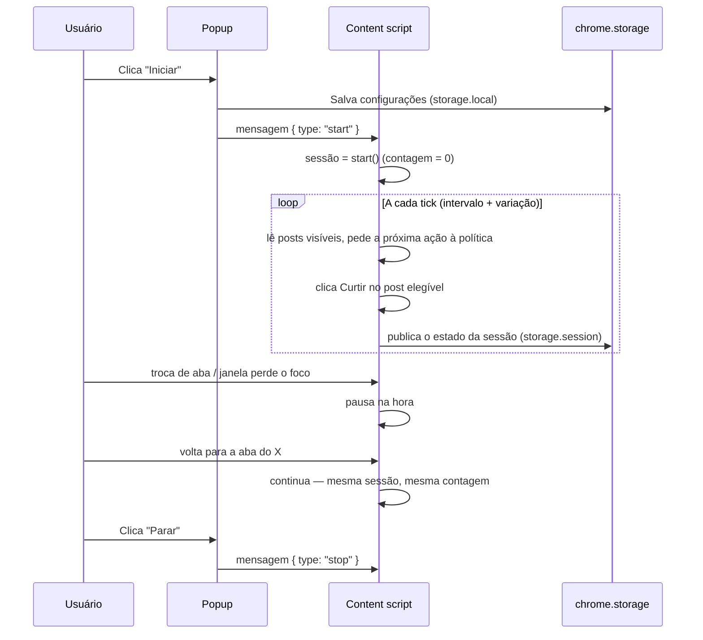

<div align="center">

# X Like Automator

**Curtir automaticamente os posts visíveis no X (Twitter) — direto na aba que você já tem aberta.**

[](LICENSE)


[](https://github.com/paladini/x-like-automator/actions/workflows/test.yml)

[English](README.md) · **Português**

</div>

---

O **X Like Automator** é uma extensão Manifest V3 que clica no botão Curtir dos posts
visíveis que ainda não foram curtidos. Ele age apenas na aba do X (ou do Twitter) que
você já deixou aberta e na qual você já entrou. Não pede senha, não lê cookies e não
usa token da API do X — ele simplesmente usa a página como você usaria, no ritmo que
você configurar.

- **Repositório:** <https://github.com/paladini/x-like-automator>
- **Versão:** [v1.1.0](https://github.com/paladini/x-like-automator/releases/tag/v1.1.0)
- **Histórico de mudanças:** [CHANGELOG.md](CHANGELOG.md)
- **Autor:** Fernando Paladini
- **Licença:** MIT

> [!AVISO]
> Curtidas automáticas podem entrar em conflito com as regras do X e com os Termos de Serviço. Você é responsável pelo uso. Sua conta pode sofrer limitações de ritmo, restrições ou suspensão. Leia o [Aviso completo](#aviso--regras-do-x) antes de rodar uma sessão.

---

## Sumário

- [Recursos](#recursos)
- [Como funciona](#como-funciona)
- [Requisitos](#requisitos)
- [Instalação](#instalação)
- [Tutorial — sua primeira sessão](#tutorial--sua-primeira-sessão)
- [Referência das configurações](#referência-das-configurações)
- [Mensagens de status](#mensagens-de-status)
- [Páginas suportadas e não suportadas](#páginas-suportadas-e-não-suportadas)
- [Privacidade e segurança](#privacidade-e-segurança)
- [Solução de problemas](#solução-de-problemas)
- [Documentação](#documentação)
- [Desenvolvimento](#desenvolvimento)
- [Contribuindo](#contribuindo)
- [Aviso — regras do X](#aviso--regras-do-x)
- [Licença](#licença)

---

## Recursos

| | |
|---|---|
| **Curtir só o que é elegível** | Posts visíveis que ainda não foram curtidos. Um post nunca é curtido duas vezes na mesma sessão. |
| **Roda na sua aba aberta** | Usa a aba do X que você já deixou aberta e na qual você já entrou. Sem fluxo de login, sem credenciais, sem token de API. |
| **Ilimitado por padrão** | A sessão não tem um teto fixo de 30 curtidas. O padrão é sem limite, até você parar. Dá para ligar um limite opcional nas configurações (1 a 1.000.000). |
| **Ritmo humano** | As curtidas são espaçadas pelo intervalo configurado (1 a 60 segundos) com uma variação pequena aleatória, sempre dentro do intervalo escolhido. |
| **Pausa automática imediata** | Se a aba ficar oculta ou a janela perder o foco, a curtida para na hora. Quando a aba volta, a mesma sessão continua, com a mesma contagem. |
| **Sessão à prova de recarga** | A aba se recarrega sozinha a cada 5 minutos (e sobrevive ao seu F5) — a sessão volta automaticamente com a mesma contagem. Só reiniciar o navegador exige apertar Iniciar de novo. |
| **Rolagem e espera automáticas** | Quando não há post elegível à vista, a extensão rola a timeline atrás de novos posts e, quando acaba, espera com backoff exponencial (até 30 s). |
| **Consciente de thread** | Opção de curtir (ou pular) o post original em uma thread de resposta. Na timeline, no perfil e na busca, os posts visíveis ainda não curtidos entram do mesmo jeito. |
| **Repost simples, opcional** | **Repostar também** vem ligado. A extensão clica no ícone de repost e depois só no item simples do menu (compartilhar sem frase). Não abre compositor e não digita. Posts já repostados são pulados. |
| **Respeita os avisos do X** | Quando o X mostra o aviso de "solicitação automatizada", a sessão espera um minuto inteiro e continua — ela não tenta driblar a proteção. |
| **Idioma da interface** | O parser usa o idioma escolhido. O padrão é Português (Brasil). O popup lista cada idioma cujos rótulos de Curtir, Descurtir, Repostar, desfazer repost e citar foram copiados dos pacotes de locale do X. |
| **Lista de recusa rígida** | Compositor de comentário ou citação, resposta, seguir, DM, login e coleta de cookies continuam recusados. |
| **Zero build, zero dependências** | JavaScript puro, carregado sem compactação direto do repositório. Os testes rodam no test runner nativo do Node. |

O popup em si é em português do Brasil (`pt-BR`); todos os rótulos estão traduzidos na
[referência das configurações](#referência-das-configurações) abaixo.

---

## Como funciona

A extensão tem três partes que se movem:

```
┌────────────┐  mensagens runtime   ┌──────────────────┐  regras puras   ┌──────────────┐
│   popup    │ ◄───────────────────►│ content script   │ ──────────────► │  policy.js   │
│ (controles,│  start / stop /      │ (leitor +        │  planTick() /   │ (motor de     │
│  opções)   │  status              │  clicador do     │  applyPlan()    │  decisão)     │
└─────┬──────┘                     │  DOM)            │                 └──────────────┘
      │                            └─────────┬────────┘
      │      chrome.storage.local            │  chrome.storage.session
      └───────── configurações ──────────────┴── estado da sessão ao vivo ──┘
```

- **`lib/policy.js`** — um motor de decisão puro e totalmente testado. Valida as
  configurações, classifica a página atual (home, perfil, busca, thread de status ou
  não suportada), escolhe o próximo post elegível, calcula o próximo delay com
  variação e decide entre curtir, repostar, rolar, observar, esperar, pausar ou parar.
- **`content/content.js`** — um adaptador de DOM. Coleta os posts da página, lê o
  estado de cada botão de curtida, clica no botão do post escolhido pela política,
  rola quando precisa, recarrega a aba a cada 5 minutos e escuta os eventos de
  visibilidade/foco. Não guarda nenhuma lógica de decisão própria.
- **`popup/popup.js`** — a interface de controle. Guarda as opções em
  `chrome.storage.local`, envia as mensagens `start` / `stop` ao content script e
  mostra o status da sessão espelhado em `chrome.storage.session`.

Um tick da sessão funciona assim:



O passo a passo completo do motor — a escada de decisão, a sub-corrente do repost, o
mecanismo de recarga-e-retomada e as costuras de teste — está em
[docs/architecture.md](docs/architecture.md) (em inglês).

---

## Requisitos

- **Um navegador Chromium com suporte a Manifest V3:** Google Chrome, Brave ou
  Microsoft Edge. A detecção de posts usa o seletor CSS `:has()`, então você precisa
  de **Chrome / Edge 105+** (ou um Brave atual).
- **Uma conta X já logada** em uma aba normal do navegador. A extensão nunca faz login
  por você e nunca toca em credenciais.
- **Node.js não é necessário para usar.** Node 20+ só para rodar os testes.

---

## Instalação

Não há etapa de build. Baixe o zip da release ou clone o repositório e carregue a pasta sem compactação. A extensão só curte posts na aba do X que você já deixou aberta. Ela não abre janela nova.

### Baixar

1. Baixe [x-like-automator-1.1.0.zip](https://github.com/paladini/x-like-automator/releases/download/v1.1.0/x-like-automator-1.1.0.zip) na [release v1.1.0](https://github.com/paladini/x-like-automator/releases/tag/v1.1.0).
2. Descompacte. A pasta precisa ter o `manifest.json` na raiz.
3. Carregue a pasta sem compactação, nos passos abaixo.

### Google Chrome

1. Baixe ou clone este repositório:
   ```bash
   git clone https://github.com/paladini/x-like-automator.git
   ```
2. Abra `chrome://extensions`.
3. Ative o **Modo do desenvolvedor** (chave no canto superior direito).
4. Clique em **Carregar sem compactação**.
5. Selecione a pasta `x-like-automator` — a que contém o `manifest.json`.
6. (Recomendado) Clique no ícone de quebra-cabeça da barra de ferramentas e
   **fixe** o *X Like Automator* para o popup ficar a um clique.

### Brave

1. Abra `brave://extensions`.
2. Ative o **Modo do desenvolvedor**.
3. Clique em **Carregar sem compactação**.
4. Selecione a pasta que contém o `manifest.json`.

### Microsoft Edge

1. Abra `edge://extensions`.
2. Ative o **Modo do desenvolvedor** (embaixo, à esquerda).
3. Clique em **Carregar sem compactação**.
4. Selecione a pasta que contém o `manifest.json`.

---

## Tutorial — sua primeira sessão

Este passo a passo leva você da timeline vazia a uma sessão rodando, pausando e
parando, explicando cada controle. A versão longa, com checklist de primeira rodada,
está em [docs/getting-started.md](docs/getting-started.md) (em inglês).

1. **Abra o X em uma aba e entre.** Vá para `https://x.com/home`. Se aparecer a
   parede de login, a extensão detecta, mostra *"Entre no X nesta aba para começar"* e
   confere de novo a cada 2 segundos — uma sessão em andamento volta sozinha assim que
   você entrar.
2. **Abra o popup.** Clique no ícone fixado do *X Like Automator*. Você vê o status
   (inicialmente `Parado`), a contagem da sessão e as opções abaixo. Abrir o popup
   **não** pausa a sessão — dá para acompanhar a contagem subindo.
3. **Ajuste o ritmo.** **Intervalo entre curtidas** (segundos). O delay real é
   aleatorizado em 85–100 % do valor (um ajuste de 5 s sorteia entre 4,25 e 5 s), o
   que deixa o ritmo menos robótico. Um ajuste de 1 s é 1 s constante.
4. **Escolha um limite (ou não).** **Sem limite de curtidas** vem ligado por padrão.
   Desmarque para usar o limite opcional **Limite de curtidas nesta sessão**
   (padrão 100): ao bater o limite a sessão para sozinha com *"Limite da sessão
   atingido"*.
5. **Chaves de thread e repost.** **Curtir o post original em uma thread de resposta**
   e **Repostar também** (só o item simples do menu) vêm ligados. A semântica exata
   está na [referência das configurações](#referência-das-configurações).
6. **Aperte Iniciar.** O status vira **"Curtindo"** e os posts começam a fluir na
   ordem da página. Posts já curtidos são pulados; nada é clicado duas vezes na mesma
   sessão.
7. **Deixe rodar.** Quando a tela fica sem elegíveis, a extensão rola ~80 % da
   viewport, observa o que carregou e, sem nada novo, espera com backoff exponencial
   até 30 s (*"Aguardando novos posts"*). A cada 5 minutos a aba se recarrega sozinha e
   a sessão volta automaticamente — mesma contagem, sem apertar nada.
8. **A pausa é automática.** Troque de aba ou minimize: a curtida pausa na hora
   (*"Pausado"*). Volte: a mesma sessão continua com a mesma contagem. Presença é o
   interruptor — não há serviço de background.
9. **Pare.** Clique em **Parar**. A contagem final fica visível no popup (o estado
   mora em `chrome.storage.session`; reiniciar o navegador limpa — aperte Iniciar de
   novo).

---

## Referência das configurações

Todas as opções são persistidas em `chrome.storage.local` e validadas antes de salvar.
Valores inválidos são recusados com erro inline no popup. A semântica completa de cada
chave está em [docs/configuration.md](docs/configuration.md) (em inglês).

| Chave | Rótulo no popup | Tipo | Faixa | Padrão |
|---|---|---|---|---|
| `intervalSeconds` | Intervalo entre curtidas (segundos) | inteiro, segundos | 1 – 60 | 5 |
| `capEnabled` | Sem limite de curtidas (invertida) | checkbox | ligado / desligado | sem limite |
| `cap` | Limite de curtidas nesta sessão (usada só com "sem limite" desligado) | inteiro | 1 – 1.000.000 | 100 |
| `likeOriginalInReplyThread` | Curtir o post original em uma thread de resposta | checkbox | ligado / desligado | **ligado** |
| `alsoRepost` | Repostar também (só o item simples do menu) | checkbox | ligado / desligado | **ligado** (ligado também quando a opção não existe no armazenamento) |
| `interfaceLanguage` | Idioma da interface (rótulos de Curtir e Repostar do parser) | escolha | 49 idiomas copiados dos pacotes de locale do X | Português (Brasil) |

Mensagens de validação mostradas pelo popup:

- *"O intervalo precisa ser um número inteiro de 1 a 60."*
- *"O limite precisa ser um número inteiro de 1 a 1000000."*

---

## Mensagens de status

A linha de status do popup é um destes oito estados (literais exatos de
`STATUS_MESSAGES` em `lib/policy.js`; semântica e tons estão em
[docs/configuration.md](docs/configuration.md)).

| Chave | Popup (pt-BR) | Significado |
|---|---|---|
| `stopped` | `Parado` | Nenhuma sessão rodando. |
| `running` | `Curtindo` | Sessão ativa curtindo posts elegíveis. |
| `paused_inactive` | `Pausado: a aba do X não está ativa` | Pausa automática (aba oculta ou janela sem foco). Volta quando você retorna (o popup abrevia para `Pausado`). |
| `waiting_for_posts` | `Aguardando novos posts` | Nada elegível à vista; rolando/esperando (backoff até 30 s). |
| `not_logged_in` | `Entre no X nesta aba para começar` | Parede de login detectada. Conferida de novo a cada 2 s. |
| `cap_reached` | `Limite da sessão atingido` | O limite opcional foi atingido; a sessão parou sozinha. |
| `unsupported_page` | `Esta página do X não entra na curtida automática` | Você navegou para uma página não suportada. Conferida a cada 2 s; voltar retoma a sessão. |
| `automation_wait` | `O X pediu para esperar. A sessão continua daqui a pouco.` | O X mostrou o aviso de atividade incomum. A sessão espera 60 s e volta sozinha. |

---

## Páginas suportadas e não suportadas

O motor classifica a URL atual em uma *superfície*. Só estas entram na curtida
automática:

| Superfície | Exemplos | Notas |
|---|---|---|
| Timeline inicial | `x.com/`, `x.com/home` | O caso clássico. |
| Busca | `x.com/search?q=…` | Os resultados visíveis são curtidos de cima a baixo conforme você rola. |
| Perfil | `x.com/<handle>`, mais as abas `with_replies`, `media` e `likes` | Posts entram só se ainda não forem curtidos — na aba *Curtidas*, tudo já foi curtido, então nada novo será clicado. |
| Post único / thread | `x.com/<handle>/status/<id>` | Respostas são curtidas na ordem da página; o post original segue a chave de thread. |

Todo o resto — `explore`, `notifications`, `messages`, `settings`, `compose` e
qualquer site fora do X — mostra **"Esta página do X não entra na curtida
automática"** e é conferido de novo a cada 2 segundos. Volte para uma página
suportada e a sessão continua exatamente de onde parou.

---

## Privacidade e segurança

A extensão declara o mínimo de APIs do Chrome que precisa:

| Permissão | Por quê |
|---|---|
| `storage` | Salvar configurações (`storage.local`) e espelhar o estado da sessão ao vivo no popup (`storage.session`). |
| Acesso aos hosts: `https://x.com/*`, `https://twitter.com/*` | O content script precisa rodar nas páginas do X e o popup precisa mandar mensagens para ele. |

O que ela **nunca** faz (cada item é garantido por teste em `test/manifest.test.js`):

- ❌ Não lê nem escreve cookies, senhas, tokens de sessão ou chaves de API do X.
- ❌ Não faz requisições de rede próprias — nada de `fetch`/XHR, analytics ou
  telemetria. Todo o estado fica em `chrome.storage`.
- ❌ Não toca em outros sites. O content script só é injetado em `x.com` e
  `twitter.com`.
- ❌ Não abre compositor, não cita, não responde, não segue, não manda DM, não faz
  login, não coleta cookies. O repost simples é o único clique extra, e só no item do
  menu que compartilha sem frase.

Detalhes de comportamento — regras de elegibilidade, a garantia de nunca desfazer,
estado volátil, memória por sessão — em
[docs/behavior-and-limits.md](docs/behavior-and-limits.md) (em inglês). Para
reportar vulnerabilidades em particular, veja [SECURITY.md](SECURITY.md).

---

## Solução de problemas

Os seis primeiros. O catálogo completo de sintoma → causa → correção está em
[docs/troubleshooting.md](docs/troubleshooting.md) (em inglês).

| Sintoma | Correção |
|---|---|
| *"Abra uma aba do X para iniciar."* | Aperte Iniciar com uma aba `x.com` / `twitter.com` ativa. |
| *"Recarregue a aba do X e toque em Iniciar de novo."* | Recarregue a aba do X (F5) e aperte Iniciar — a aba é anterior à instalação/atualização. |
| Status fica `Parado` depois de reiniciar o navegador | Esperado: o estado da sessão é volátil por design. Aperte Iniciar (as opções sobrevivem). |
| `Pausado: a aba do X não está ativa` para sempre | Clique na aba do X — a sessão volta com a mesma contagem. |
| `Esta página do X não entra na curtida automática` | Volte para a timeline, busca, um perfil ou uma thread. |
| *"Esta solicitação parece ser automatizada…"* | Nada a fazer — a sessão espera um minuto e continua. Use intervalo maior ou limite se ficar repetindo. |

---

## Documentação

Os guias técnicos abaixo estão em inglês:

| Guia | O que cobre |
|---|---|
| [docs/getting-started.md](docs/getting-started.md) | Instalação completa, primeira sessão passo a passo, checklist de primeira rodada. |
| [docs/configuration.md](docs/configuration.md) | Semântica de cada opção, mensagens exatas de validação, tons de status, URLs suportadas. |
| [docs/architecture.md](docs/architecture.md) | A escada de decisão, a sub-corrente do repost, recarga-e-retomada, costuras de teste. |
| [docs/behavior-and-limits.md](docs/behavior-and-limits.md) | Invariantes de segurança, regras de elegibilidade, o que cada contador prova, privacidade em detalhe. |
| [docs/localization.md](docs/localization.md) | Como os 49 pacotes de idioma do X são copiados e usados, e os failsafes. |
| [docs/faq.md](docs/faq.md) | Respostas curtas: o aviso de automação, comportamento do F5, limites, design do ritmo. |
| [docs/troubleshooting.md](docs/troubleshooting.md) | O catálogo completo de problemas. |

Arquivos do projeto: [CONTRIBUTING.md](CONTRIBUTING.md) · [CHANGELOG.md](CHANGELOG.md) ·
[SECURITY.md](SECURITY.md) · [CODE_OF_CONDUCT.md](CODE_OF_CONDUCT.md) ·
[workflow de CI](.github/workflows/test.yml) · [templates de issue](.github/ISSUE_TEMPLATE).

---

## Desenvolvimento

Sem etapa de build, sem dependências de runtime. O repositório inteiro é a extensão.

```bash
git clone https://github.com/paladini/x-like-automator.git
cd x-like-automator
npm test        # roda node --test (Node 20+); sem etapa de instalação
```

A regra de arquitetura que mantém os testes honestos: `lib/policy.js` é dona de cada
decisão (um laço puro `planTick` → `applyPlan`, sem DOM) e `content/content.js` é dona
de cada interação com o DOM atrás de funções pequenas injetadas. Mantenha lógica de DOM
fora da política e lógica de decisão fora do adaptador.

O guia completo de ambiente, layout do repositório, disciplina de testes e processo de
PR está em [CONTRIBUTING.md](CONTRIBUTING.md) (em inglês).

---

## Contribuindo

Contribuições são bem-vindas. Versão curta: fork, branch a partir de `main`, um
comportamento por PR, cada mudança de comportamento adiciona ou atualiza um teste,
`npm test` verde, Conventional Commits. Abra uma issue antes para qualquer coisa maior
que um fix — a lista de recusa e o escopo "só a aba aberta" são deliberados e
 improváveis de mudar. O guia completo está em [CONTRIBUTING.md](CONTRIBUTING.md); ao
participar você aceita o [Código de Conduta](CODE_OF_CONDUCT.md).

---

## Aviso — regras do X

Curtidas automáticas podem entrar em conflito com as regras do X e com os Termos de
Serviço. Contas que curtem em escala podem ser limitadas ou restritas. Esta extensão é
fornecida como está, para uso educacional e pessoal. Você é responsável pelo uso.
Mantenha o intervalo conservador, use um limite na dúvida, e pare imediatamente se o X
mostrar qualquer aviso.

---

## Licença

MIT © 2026 [Fernando Paladini](https://github.com/paladini). Veja [LICENSE](LICENSE).
Documentação completa em inglês: [README.md](README.md).
