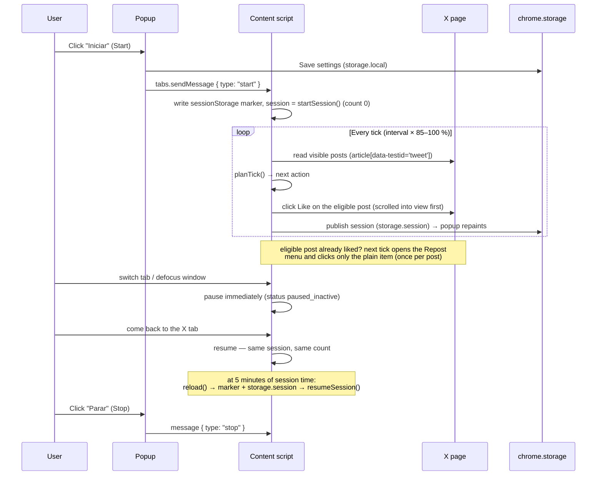

# Architecture

[← Back to README](../README.md)

X Like Automator is a Manifest V3 extension with **no background service worker**.
The design is one hard seam:

> **Policy pure, adapter thin.** `lib/policy.js` owns every decision as plain data in /
> plain data out. `content/content.js` owns every DOM and `chrome.*` interaction behind
> small injected functions. `popup/popup.js` owns only settings I/O and messaging.

That seam is what makes the entire decision engine unit-testable in plain Node with
fake-DOM harnesses (`node --test`, zero dependencies).

## Components

Three moving parts, one hard rule between them:

```
┌────────────┐  runtime messages    ┌──────────────────┐  pure rules    ┌──────────────┐
│   popup    │ ◄───────────────────►│ content script   │ ──────────────►│  policy.js   │
│ (controls, │  start / stop /      │ (DOM reader +    │  planTick() /  │ (decision    │
│  settings) │  status              │  clicker)        │  applyPlan()   │  engine)     │
└─────┬──────┘                      └────────┬─────────┘                └──────┬───────┘
      │          chrome.storage.local        │      chrome.storage.session     │
      └──────────── settings ────────────────┴──── live session state ─────────┘
```

In detail:

```
┌────────────────┐  chrome.tabs.sendMessage   ┌───────────────────┐  planTick() /    ┌──────────────┐
│  popup/popup.js│ ◄──────────────────────────►│ content/content.js│ ─── applyPlan() ─►│ lib/policy.js│
│  controller:   │  start · stop ·             │ adapter: read the │                  │ pure engine: │
│  settings I/O, │  popup-open · popup-close   │ page, perform the │  lib/ui-languages│ ladder,      │
│  live counter  │                             │ one chosen action │  .js label packs │ cadence, i18n│
└───────┬────────┘                            └────────┬──────────┘                  └──────────────┘
        │ storage.local (settings)                     │ storage.session (session)
        └──────────────────────────┬───────────────────┘
                        chrome.storage  (the only permission)
        sessionStorage marker (this tab only) — survives reload, not browser restart
```

Every script is a **classic script wrapped in an IIFE**, exposing one global:
`XLikesLanguages` (`lib/ui-languages.js`), `XLikesPolicy` (`lib/policy.js`),
`XLikesContent` (`content/content.js`), `XLikesPopup` (`popup/popup.js`). Classic
scripts share one global lexical scope; the IIFE prevents top-level constants from
colliding between the popup and the content page. None of them may use `import` /
`export` — `test/manifest.test.js` enforces it.

### `lib/policy.js` — decision engine

It touches no DOM and no `chrome.*`. Responsibilities:

- `validateSettings` — range-checks the six settings (see the
  [configuration reference](configuration.md)) and returns `{ok, errors}` with the
  exact pt-BR messages from `SETTINGS_ERRORS`.
- `classifySurface` — `home` / `search` / `profile` / `status` / `other`, over the
  two X hosts only, with a reserved-segments list so `/explore` never reads as a
  handle.
- `likeControlState` — order-sensitive classification of a Like control:
  `data-testid="unlike"` or an Unlike-label → `liked`; `data-testid="like"` → `like`;
  Like label + `aria-pressed="true"` → `liked`; Like label alone → `like`; anything
  else → `other` (**never clicked**).
- `repostControlState` / `repostMenuChoice` — fail-safe repost decisions: undo labels
  or `aria-pressed="true"` mean already-reposted; the menu scan clicks **only** the
  plain Repost item when it is positively present; quote/unknown menus get `escape`.
- `annotateThread` — on a `status` surface, marks the first non-reply post as
  `original`; the reply-thread toggle then gates it.
- `selectNextAction` — walks posts in page order: numeric id required; likes first,
  then (when `alsoRepost` is on) the plain repost, each once per session.
- `nextDelayMs` — the jitter formula: 1 s is constant; otherwise
  `round(interval × (0.85 + 0.15 × unit))` ms, clamped to `[1000, interval × 1000]`.
- `planTick(state)` — the decision ladder, first rung that matches wins:
  ① not running → ② presence (`activityDecision`) → ③ login wall → ④ automation
  notice → ⑤ cap → ⑥ surface → ⑦ pending repost confirm → ⑧ next eligible like /
  repost-open → ⑨ scroll ladder (`scrollDecision`: scroll → observe → wait+backoff).
- `applyPlan(session, plan, settings)` — returns a **new** session object
  (immutability) carrying `likeCount`, `seenIds`, `repostDoneIds`, `pendingRepostId`,
  `stopReason`, `backoffStep`, and `startedAt`.
- `startSession` / `resumeSession` / `stopSession` — session lifecycle; resume keeps
  `likeCount` but starts a fresh sweep.

### `content/content.js` — DOM adapter

`createSessionRunner({...})` receives every side effect as an injected function —
`getSettings`, `readSnapshot`, `clickLike`, `openRepost`, `confirmRepost`, `scrollBy`,
`publish`, `schedule`, `cancel`, `randomUnit`, `now`, `reload` — so tests can fake the
entire page. The real `boot()` wires those to `document`, `window`, and `chrome.*`.

Key DOM facts it encodes:

- **Post container:** `article[data-testid='tweet']`, plus `article:has(button[data-testid='like'|'unlike'])`
  and per-label `article:has(button[aria-label='<Like label>'])` fallbacks. Only the
  **outermost** article counts (`!article.parentElement?.closest("article")`) — quoted
  and nested posts are ignored.
- **Post id:** numeric id extracted from a `…/status/<id>` link inside the article
  (`articleStatusId`); a post without one is never eligible.
- **Reply detection:** `[data-testid='socialContext']` or a "replying to / respondendo
  a" phrase.
- **Repost menu discovery:** first the stable `[data-testid='retweetConfirm']` anchor,
  then `[role='menu']`, `[data-testid='Dropdown']`, and `[data-testid='sheetDialog']`
  roots; if neither yields a wanted label, an exact-label scan across the document
  (excluding anything inside an `article`, which would just toggle the menu shut).
- **Scroll targets:** the document or `[data-testid='primaryColumn']`, whichever
  actually scrolls; each auto-scroll is `max(240 px, 0.8 × viewport)`.
- **Login wall:** no posts rendered **and** a login/signup control or login URL
  (`/login`, `/i/flow/login`, `/i/jf/onboarding/web`).
- **Automation notice:** the page text contains
  `"Esta solicitação parece ser automatizada"` → wait exactly 60 s (`AUTOMATION_WAIT_MS`).

### `popup/popup.js` — controller

Persists validated settings to `chrome.storage.local` on **Start**, delivers
`start` / `stop` / `popup-open` / `popup-close` through `chrome.tabs.sendMessage`
(never `runtime.sendMessage` — the contract in `test/manifest.test.js`), and repaints
from `chrome.storage.session` change events. An epoch ticket discards stale async
replies so the freshest user action always wins the paint. With no reachable X tab it
shows *"Abra uma aba do X para iniciar."* or, for a tab without the content script,
*"Recarregue a aba do X e toque em Iniciar de novo."* — no crash.

## Data flow: one tick

1. `getSettings()` → validated settings from `storage.local` (falls back to defaults).
2. `readSnapshot(settings)` → page data: posts (liked / reposted / reply flags),
   presence flags, login wall, automation notice, scroll deltas.
3. `planTick(ctx)` → one plan: `{action, status, waitMs, postId? | scrollTarget?}`.
4. The adapter executes only that action; the result is reported as `performed`
   (a failed like degrades to `wait`, a failed repost to `repost-retry`).
5. `applyPlan` → new immutable session; counters advance.
6. `publish(snapshot)` → popup repaints; the timer schedules the next tick at
   `performed.waitMs`.

## One session, start to finish



## Cadence: jitter inside the interval

`nextDelayMs` never exceeds the configured interval: a unit random draw maps to
85–100 % of it (1 s is a special case at exactly 1 s). The adapter draws
`randomUnit()` per tick — tests inject fixed values to assert the exact schedule. The
scroll ladder interleaves its own timings: `OBSERVE_WAIT_MS = 500` after a scroll that
moved or changed the post set, then exponential backoff `2000 × 2^step` capped at
30000 ms, resetting to 0 the moment anything eligible is liked.

## Repost sub-chain

`planTick` arms `pendingRepostId` when it emits `repost-open`; the next tick's plan is
`repost-confirm`, which reads the open popover and delegates to
`repostMenuChoice`:

- plain Repost label present → click it, mark `repostDoneIds`, count nothing extra;
- undo label present (already reposted) → `escape`, mark done, skip;
- nothing matched → `escape`, mark done, skip — **the composer is never opened and no
  text is ever typed**.

If the button click or the menu read fails outright, the runner's retry ladder
(`REPOST_RETRIES = 3`, one second apart) re-emits `repost-retry`; after three misses
the post is marked handled so the session never loops on one stubborn post.

## Reload & resume

At `now − startedAt ≥ PAGE_RELOAD_MS` (300000 ms = 5 minutes) the adapter calls
`location.reload()`. On boot the content script checks a **per-tab `sessionStorage`
marker** (`x-like-automator:session-tab`) plus a `storage.session` snapshot reporting
`running: true`; only when both agree does it `resumeSession` — counters survive, the
sweep restarts from the live page state. A second X tab has no marker and stays idle
— no cross-tab session theft. A browser restart clears `storage.session`, so a fresh
press of Start is required (nothing sensitive persists).

## Presence rules

`activityDecision` pauses on a hidden document; a blur pauses after a
`POPUP_FOCUS_GRACE_MS = 200` grace period unless the popup is open — opening the popup
marks the session `"popup open"` and never pauses a run. `visibilitychange`, `blur`,
and `focus` events call `onHide` / `onShow` / `onBlur` on the runner.

## Test seams

- `test/policy.test.js` — the whole ladder and `applyPlan` matrix on plain data,
  jitter grid, classification, menu choice.
- `test/content-adapter.test.js` — `createSessionRunner` with fully injected fakes:
  schedules, click gating, repost retries, scroll arming, reload-and-resume.
- `test/popup-*.test.js` — controller, markup, and CSS contracts with fake chrome APIs.
- `test/manifest.test.js` — shipped-file purity: MV3, no background, `storage` only,
  no `import`/`export`, the two X hosts, PNG-only icons.
- `test/readme.test.js` + `test/docs.test.js` — the documentation set as contract.

Next: [Behavior and limits](behavior-and-limits.md) · [Localization](localization.md) ·
[Troubleshooting](troubleshooting.md) · [← Back to README](../README.md)
